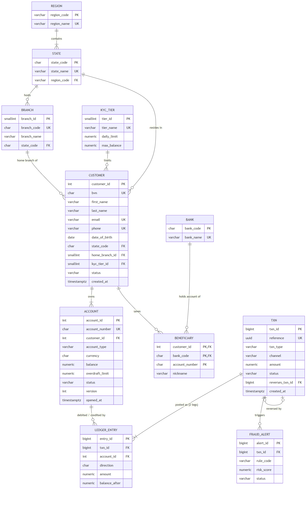
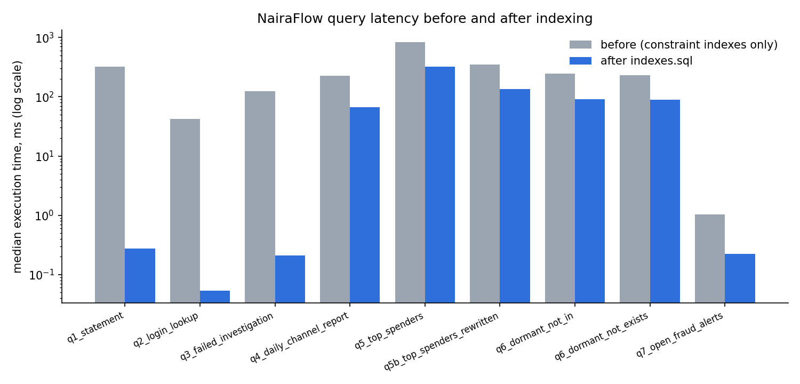

# MIT 8103 Advanced Database Systems: Portfolio Documentation

**Student:** `<YOUR NAME>` · **Matric no.:** `<YOUR MATRIC NUMBER>` · **GitHub:** `<https://github.com/YOUR-USERNAME/advanced-database-portfolio>` (private; assessor added as collaborator)

## 1. Selected organisation

**NairaFlow Digital Bank** (simulated) is a Nigerian digital bank offering savings, current and wallet accounts over mobile, web, USSD, POS, ATM and branch channels. Its database is used by customers (through the apps), customer service, operations and reconciliation, the fraud desk, finance and compliance. It stores customers with BVN-based KYC tiers, accounts, transactions, a double-entry ledger, beneficiaries, fraud alerts and an audit trail. It supports opening accounts, atomic fund transfers, reversals, statements, balance reconciliation, fraud investigation and channel reporting. A reproducible generator produced 20,001 customers, 29,482 accounts, 630,985 transactions and 1,183,886 ledger entries covering January 2025 to October 2026, and this dataset is used in all five portfolios.

## 2. Portfolio 1: Database Design and Modelling

A 12-table PostgreSQL 17 schema normalised to 3NF/BCNF (the walk-through from an unnormalised "transfer slip" is in `normalisation.md`). The central design is a **double-entry ledger**: every money movement is a `txn` header plus debit and credit `ledger_entry` legs. Rules are enforced in the database:
- 30+ CHECK/UNIQUE/FK constraints (e.g. 11-digit BVN, 18+ customers, overdraft only on current accounts)
- a **deferred constraint trigger** (debits = credits, checked at COMMIT)
- an **append-only** trigger on the ledger
- an **audit trigger** that writes JSONB before/after images
- a `transfer_funds()` procedure with idempotency and deadlock-free lock ordering

`account.balance` is a deliberate, guarded denormalisation, and reconciliation confirms 0 drift. A negative test suite shows **15/15 invalid operations rejected**.

## 3. Portfolio 2: Query Processing and Optimisation

Nine business queries were measured before and after indexing (median of 7 `EXPLAIN (ANALYZE, BUFFERS, TIMING OFF)` runs; full plans committed). Each index fixed a problem seen in a plan:

| Query | Before → after | Technique |
|---|---|---|
| Account statement | 318.6 → 0.27 ms | Composite covering index, Index Only Scan, no Sort |
| Login by e-mail | 41.9 → 0.05 ms | Expression index on `lower(email)` |
| Failed-transfer queue | 123.8 → 0.21 ms | Partial index `WHERE status='FAILED'` |
| Daily channel report | 223.7 → 66.8 ms | BRIN (32 kB vs 13 MB for a B-tree) |
| Top spenders | 828.7 → 135.3 ms (99 ms via materialised view) | Query rewrite: aggregate first, join 10 rows |

The study also compares NOT IN with NOT EXISTS (hashed SubPlan vs Hash Anti Join, and the NULL trap) and forces hash, merge and nested-loop joins.

## 4. Portfolio 3: Transactions and Concurrency

Twelve experiments, each with two or more real concurrent connections and a timestamped transcript:
- **Commit, rollback, savepoint** and a deferred constraint aborting a one-legged posting.
- **Lost update** reproduced under READ COMMITTED (14,000 withdrawn from 10,000; reconciliation flagged -7,000), then fixed three ways: `SELECT … FOR UPDATE` (S2 blocked 1.63 s), optimistic `version` check (0 rows updated) and REPEATABLE READ (SQLSTATE 40001).
- **Non-repeatable read** (READ COMMITTED vs REPEATABLE READ).
- **Write skew**: allowed under REPEATABLE READ (combined balance -6,000) and prevented under SERIALIZABLE.
- **Deadlock**: detected after 1 s with 40P01; ordered locking then gave 0 deadlocks in 400 concurrent transfers.
- **Idempotent retries.**

## 5. Portfolio 4: NoSQL and Advanced Data Models

The same data was migrated to **MongoDB**:
- customers with embedded accounts (one read for the app home screen)
- transactions with embedded legs
- monthly statement buckets (bucket pattern)
- `$jsonSchema` validation and `Decimal128` money

Indexes turned COLLSCANs of 82,072 documents into IXSCANs examining 1-50 keys. Other results:
- Aggregation pipelines reproduced the SQL reports.
- A multi-document ACID transfer committed, aborted and rolled back on a duplicate reference.
- `$graphLookup` traced a flagged transfer through 3 hops (82/195/205 onward transfers, 43 ms).

**Redis** provided cache-aside (4.59 → 1.13 ms), idempotency keys (`SET NX EX`), a sliding-window velocity limit, a leaderboard and sessions. Suitability conclusion: PostgreSQL stays the system of record for the ledger, MongoDB serves profiles, history and graph look-ups, and Redis handles ephemeral, high-speed state.

## 6. Portfolio 5: Distributed and Cloud Databases

- **PostgreSQL streaming replication** (1 synchronous + 1 asynchronous standby): identical data on 3 nodes, read-only standbys, 1.4 ms median replica lag.
- **Sync-standby outage:** commits blocked (`IPC/SyncRep`), i.e. consistency chosen over availability.
- **Primary crash under live load:** all **218/218 acknowledged transfers survived (RPO = 0)** and the promoted standby accepted writes **3.2 s** after the crash.
- **Citus:** sharding by `customer_id` (co-located, with reference tables) gave single-shard router queries (0.35 ms), 8-task parallel analytics, and **two-phase commit** for cross-shard transfers. It also exposed 60/40 data skew from hot customers.
- **MongoDB 3-node replica set:** elected a new primary about 13 s after a crash, with no lost majority writes. It refused writes when quorum was lost.
- **Cloud:** a proposed AWS design (RDS Multi-AZ PostgreSQL, read replica, ElastiCache, MongoDB Atlas) is captured in Terraform (not applied), with Nigerian data-residency considerations.

## 7. Evidence, reflection and declaration

All scripts, raw execution plans, transcripts and logs are in the repository (`results/` folders). The individual technical reflection is in `docs/individual-reflection.md`, and the AI use declaration and references are in `docs/ai-use-declaration-and-references.md`.
