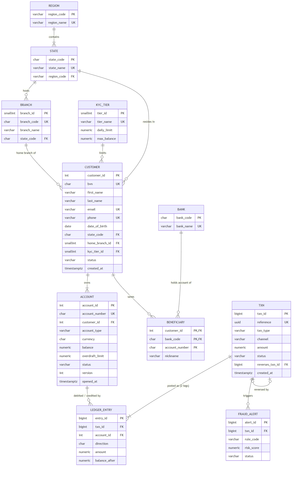

# Portfolio 1: Database Design and Modelling

## Case study: NairaFlow Digital Bank (simulated)

**NairaFlow** is a simulated Nigerian digital bank (a CBN-licensed microfinance bank model) that runs savings, current and wallet accounts. Customers use a mobile app, the web, USSD, POS agents, ATMs and branches.

| Item | Description |
|---|---|
| **Nature of business** | Retail digital banking: account opening (BVN-based KYC), deposits, withdrawals, inter-account transfers, reversals of disputed transfers, fees, fraud monitoring |
| **Database users** | Customers (through the apps), customer-service agents, the operations/reconciliation team, the fraud desk, finance/reporting, compliance auditors, and the core-banking services themselves |
| **Major data** | Customers and KYC tier, accounts and balances, transactions (headers), double-entry ledger entries, saved beneficiaries at other banks, fraud alerts, an audit trail, reference data (states, regions, branches, banks) |
| **Key operations** | Open account, transfer funds atomically, reverse a failed or disputed transfer, produce account statements, audit balances against the ledger, flag and investigate suspicious transfers, report daily volumes per channel |

The same case study is used in all five portfolios.

## Files

| File | Purpose |
|---|---|
| [`schema.sql`](schema.sql) | Full DDL: 12 tables, keys, 30+ constraints, 3 triggers, the `transfer_funds` procedure, a view |
| [`er-diagram.mmd`](er-diagram.mmd) / [`er-diagram.png`](er-diagram.png) | ER diagram (Mermaid source and rendered image; GitHub also renders the source below) |
| [`normalisation.md`](normalisation.md) | UNF → 1NF → 2NF → 3NF → BCNF walk-through, plus the deliberate denormalisations |
| [`load_data.py`](load_data.py) | Deterministic generator that simulates 22 months of banking activity and bulk-loads it with `COPY` |
| [`test_constraints.py`](test_constraints.py) → [`constraint_tests.md`](constraint_tests.md) | 15 negative tests proving each rule rejects bad data |
| [`load_output.txt`](load_output.txt) | Captured output of the data load |

## ER diagram



## Key design decisions

1. **Double-entry ledger.** A money movement is one `txn` row plus balanced `ledger_entry` legs (debit = credit). Deposits debit the bank's own cash GL account, so even cash in and out balances. This is how real core-banking systems make money impossible to create or destroy by accident.
2. **Surrogate and natural keys.** Identity columns (`customer_id`, `account_id`, `txn_id`) are the primary keys, so joins stay on small integers. Real-world identifiers (`bvn`, `email`, `phone`, NUBAN `account_number`, the UUID `txn.reference`) are declared `UNIQUE` as alternate keys.
3. **Rules live in the database.** Rules are enforced with CHECK, FK and UNIQUE constraints, a **deferred constraint trigger** (debits = credits, checked at COMMIT because a row-level CHECK cannot see the other leg), an **append-only trigger** (ledger rows can never be edited, only reversed), and an **audit trigger** that stores JSONB before/after images of every account change.
4. **`transfer_funds()` stored procedure.** This is the one sanctioned way to move money. It checks idempotency by reference, locks both accounts in a deterministic order (to prevent deadlocks, demonstrated in Portfolio 3), validates status and funds, then writes the header, both balances and both legs in one transaction.
5. **NUMERIC(18,2) for money.** Never floating point.
6. **Controlled denormalisation.** `account.balance` and `ledger_entry.balance_after` are derived values that are stored for speed. The justification and safeguards are in [`normalisation.md`](normalisation.md#deliberate-controlled-denormalisation).

## Dataset (generated, reproducible)

`load_data.py` uses a fixed random seed, so the same data is produced every time. It simulates activity in time order. Transfers that would overdraw an account are stored as `FAILED` with no ledger legs, and 0.4% of transfers are disputed and reversed. Activity per account follows a Zipf-like curve (a few very busy accounts, many quiet ones), which gives realistic skew for the optimiser in Portfolio 2.

| Table | Rows |
|---|---:|
| ledger_entry | 1,183,886 |
| txn | 630,985 |
| account | 29,482 |
| customer | 20,001 |
| beneficiary | 10,000 |
| fraud_alert | 6,040 |

After loading, two set-based checks must return zero: unbalanced transactions = **0** and accounts whose stored balance differs from the ledger = **0** ([`load_output.txt`](load_output.txt)).

> **Lesson recorded during the build:** my first version of the balance check used a correlated subquery (`WHERE balance <> (SELECT sum(...) FROM ledger_entry l WHERE l.account_id = a.account_id)`). With no index on `ledger_entry.account_id` yet, it re-scanned 1.18M rows for each of the 29k accounts and was still running after 8 minutes. Rewriting it as one `GROUP BY` aggregate joined to `account` finished in about a second. That led straight into Portfolio 2.

> **Second lesson:** the first data load *failed* because the `customer_adult` CHECK rejected generated customers who were under 18 on their sign-up date. The constraint caught a bug in my generator. I fixed the generator, not the constraint.

## How to run

```bash
docker compose up -d postgres            # from the repo root
python portfolio-1-database-design/load_data.py
python portfolio-1-database-design/test_constraints.py
```
