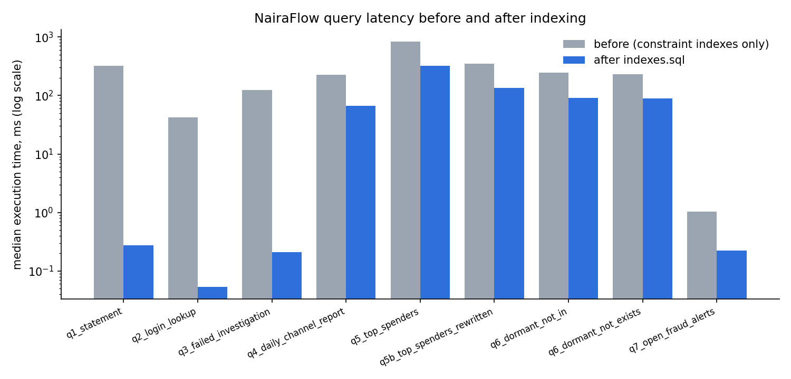
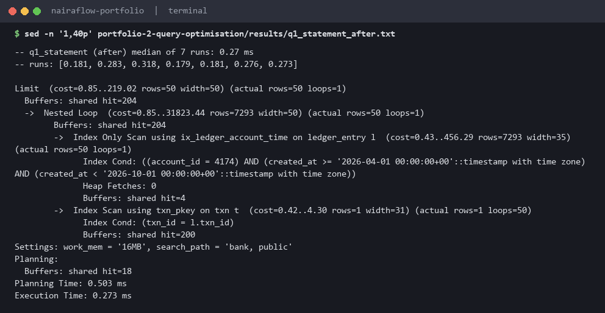
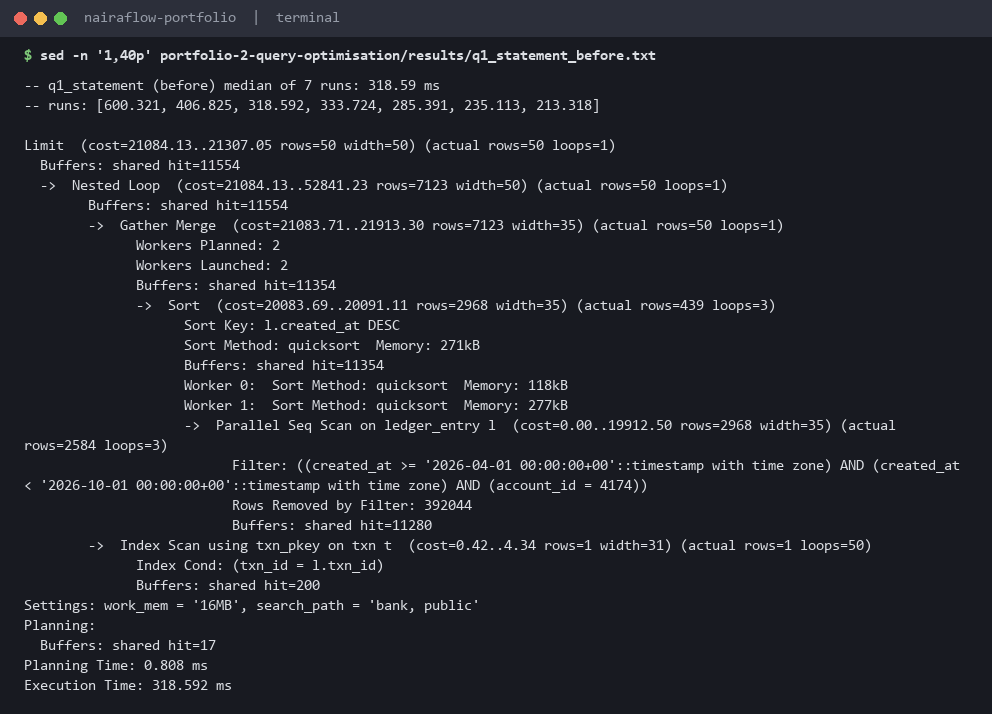
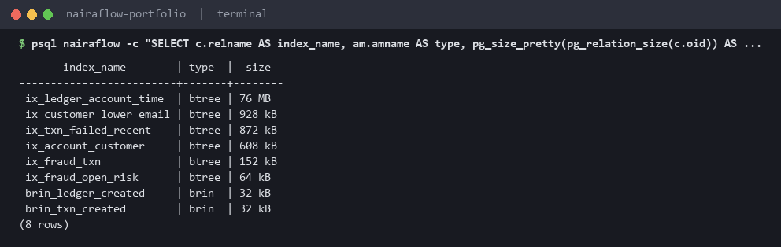
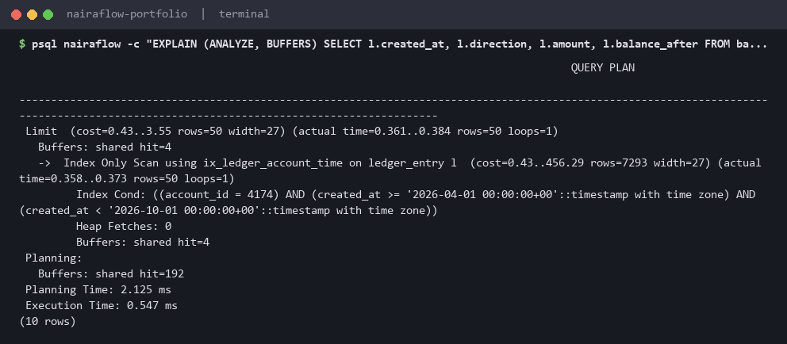
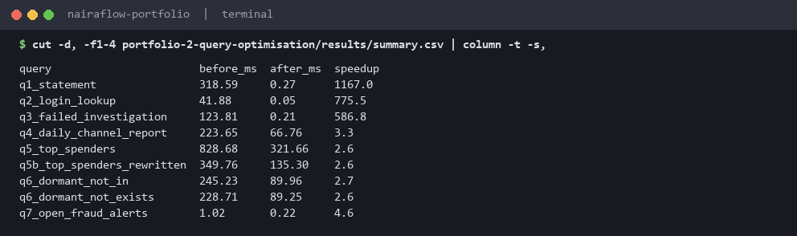

# Portfolio 2: Query Processing and Optimisation

All measurements are on the Portfolio 1 dataset (20k customers, 29k accounts, 631k transactions, 1.18M ledger entries) in PostgreSQL 17 running in Docker.

## Files

| File | Purpose |
|---|---|
| [`queries.sql`](queries.sql) | 9 business queries (statement, login, ops queue, finance report, analytics, compliance, fraud desk) |
| [`indexes.sql`](indexes.sql) | 8 indexes, each chosen from a specific baseline plan |
| [`run_benchmarks.py`](run_benchmarks.py) | Drops the tuning indexes, measures, builds the indexes, measures again, then runs 3 extra experiments |
| [`results/summary.md`](results/summary.md) | Generated results tables |
| `results/<query>_before.txt` / `_after.txt` | Full `EXPLAIN (ANALYZE, BUFFERS, SETTINGS)` plans, before and after |
| [`results/timings.png`](results/timings.png) | Chart of before/after latency |

**Method.** Each query gets 1 warm-up run plus 7 measured runs of `EXPLAIN (ANALYZE, BUFFERS, TIMING OFF)`, and the median *Execution Time* is reported. `TIMING OFF` is used because per-node clock calls added up to 2x overhead on row-heavy plans inside Docker on Windows. One plan with full per-node timing is saved for each query as evidence. The "before" state keeps only the indexes that come with PK/UNIQUE constraints.

> **Measurement caveat:** the host machine was heavily loaded while these were captured (about 80% CPU from other applications, under 1 GB free RAM). Repeat runs varied by up to 2x for the long analytic queries (Q4-Q6). Conclusions are drawn from plan shape and buffer counts, which are deterministic, as well as from time.

## Results



| Query | Before (ms) | After (ms) | Speed-up | Plan change |
|---|---:|---:|---:|---|
| Q1 account statement | 318.6 | 0.27 | ~1,170x | Parallel Seq Scan of 1.18M rows → **Index Only Scan** on `ix_ledger_account_time` |
| Q2 login by e-mail | 41.9 | 0.05 | ~780x | Seq Scan → **expression index** `lower(email)` |
| Q3 failed-transfer queue | 123.8 | 0.21 | ~590x | Parallel Seq Scan → **partial index** `WHERE status='FAILED'` |
| Q4 daily channel report | 223.7 | 66.8 | 3.3x | Seq Scan → **BRIN** bitmap scan on `created_at` |
| Q5 top spenders (original) | 828.7 | 321.7 | 2.6x | BRIN bitmap scan on the ledger, then hash joins |
| Q5b top spenders (rewritten) | 349.8 | 135.3 | 2.6x vs itself, **6.1x** vs the original baseline | Aggregate first, join names for 10 rows only |
| Q6 dormant accounts (NOT IN) | 245.2 | 90.0 | 2.7x | Hashed SubPlan + BRIN |
| Q6 dormant accounts (NOT EXISTS) | 228.7 | 89.3 | 2.6x | Hash Anti Join + BRIN |
| Q7 fraud desk queue | 1.0 | 0.22 | 4.6x | Seq Scan → partial index on `OPEN` alerts |

Full table: [`results/summary.md`](results/summary.md).

## Analysis

**Q1: composite, covering index (the biggest win).** The baseline plan read the whole `ledger_entry` table in parallel to find about 150 rows for one account. `ix_ledger_account_time (account_id, created_at DESC) INCLUDE (...)` puts the equality column first and the range/sort column second. The index therefore returns rows already in `ORDER BY created_at DESC` order, so the `Sort` node disappears and the `LIMIT 50` stops early. `INCLUDE` makes it an *index-only* scan: it never touches the heap (`Heap Fetches: 0` after `VACUUM`). The cost is a 76 MB index, the largest in the schema, which is justified because this is the most frequent query in a banking app.

**Q2: expression index.** `WHERE lower(email) = lower($1)` cannot use the `UNIQUE(email)` index because the indexed value is `email`, not `lower(email)`. That's why the baseline is a Seq Scan even though an index already existed on the column. The expression index matches the predicate exactly.

**Q3 and Q7: partial indexes.** Only about 4% of transactions are `FAILED` and only a third of alerts are `OPEN`. A partial index stores just those rows (872 kB and 64 kB), and normal `COMPLETED` inserts never have to maintain it. The planner can only use it when the query's `WHERE` implies the index predicate.

**Q4 and Q5: BRIN vs B-tree.** `txn` and `ledger_entry` are append-only and inserted in time order, so `created_at` correlates almost perfectly with physical order. A BRIN index stores just the min/max per range of 32 pages: **32 kB versus 13 MB** for the equivalent B-tree (about 400x smaller). The plans show the trade-off: `Heap Blocks: lossy=…` and `Rows Removed by Index Recheck`. BRIN finds candidate block ranges, not rows. For a report that touches a whole month that is the right choice. For a point lookup it would not be.

**Q5: indexing alone is not enough; rewrite the query.** After indexing, Q5 still spends most of its time *above* the scan. It joins about 80k debit rows to account, customer, state and region, then hash-aggregates on a computed `first_name || ' ' || last_name` string. Q5b aggregates `ledger_entry` by integer `account_id` first, rolls up to customer, applies `LIMIT 10`, and only joins names and regions for those 10 rows. Same result, 2.4x faster than indexed Q5. For a report that is run all day, the **materialised view** `mv_monthly_outflow` (pre-aggregated per customer per month, built in 2.4 s) answers it in **99 ms**. The trade-off is staleness until the next `REFRESH MATERIALIZED VIEW CONCURRENTLY`. The script checks that all three versions return the *same top-10 customers*.

**Q6: NOT IN vs NOT EXISTS.** On this data both run at about the same speed (90 ms). PostgreSQL turned NOT EXISTS into a **Hash Anti Join** and NOT IN into a **hashed SubPlan** (the subquery fits in `work_mem`). They are only semantically equal because `ledger_entry.account_id` is `NOT NULL`. If the subquery could return a NULL, `NOT IN` would return *no rows at all*. NOT EXISTS is the safer form, and with a larger subquery the hashed SubPlan would spill and degrade, while the anti-join would not.

**Join algorithms (Q5 with planner settings forced).** With `enable_hashjoin=off` the planner fell back to merge join + nested loop. With hash and merge both off it used only nested loops, the slowest at 735 ms. A nested loop on 80k outer rows means 80k index probes, whereas a hash join builds one hash table of the 29k accounts and probes it in memory. In one run the merge-join variant measured faster than the planner's hash-join choice. With run-to-run noise of up to 2x on this host, that difference is within error. It also shows the planner chooses by *estimated* cost, which doesn't always match measured time.

**Index cost.** The 8 indexes add about 79 MB and took 5.7 s to build. Every index slows down `INSERT`s into its table, which is why `txn` and `ledger_entry` (the write-hot tables) use BRIN and partial indexes wherever possible, and only Q1's covering B-tree is "expensive".

## Screenshots

Terminal captures produced by [`scripts/capture_evidence.py`](../scripts/capture_evidence.py): each image is the real output of the command shown in its title bar (a live `psql` query against the lab database, or the command that prints a committed results file).

**AfterIndex**



**BeforeIndex**



**IndexSizes**



**LiveIndexedStatement**



**Summary**



## How to run

```bash
python portfolio-2-query-optimisation/run_benchmarks.py     # ~3 minutes, rewrites results/
```
