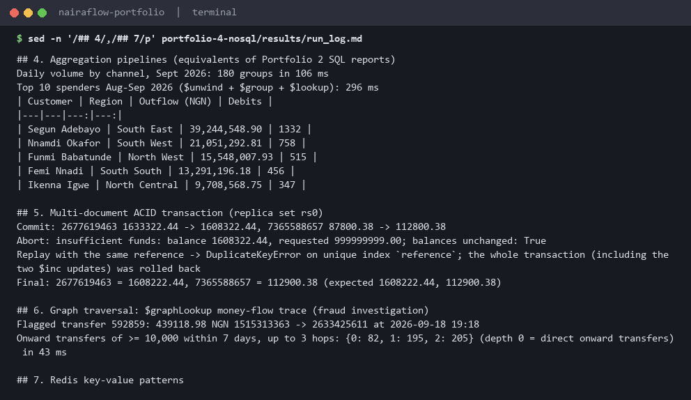
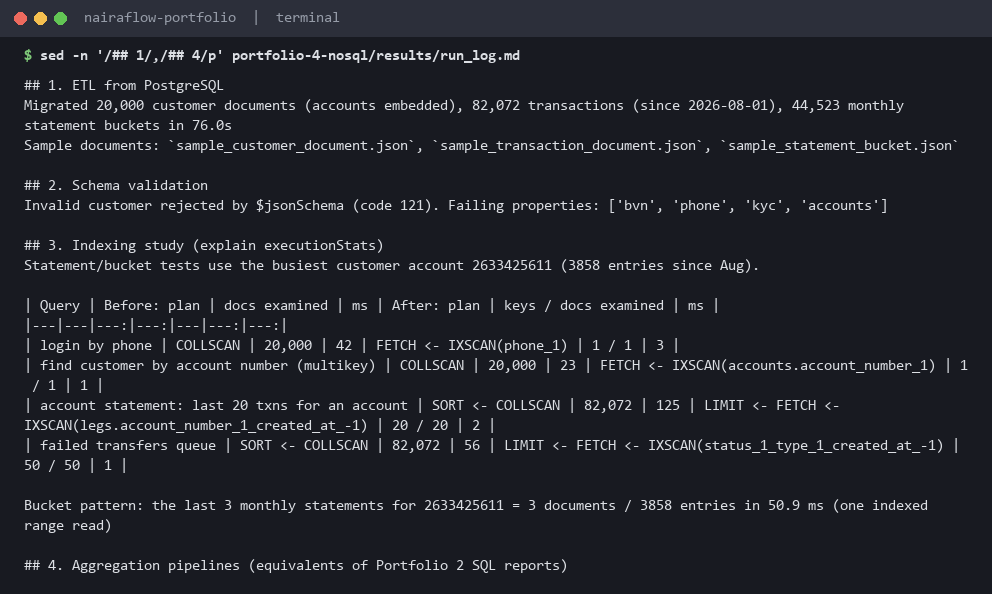
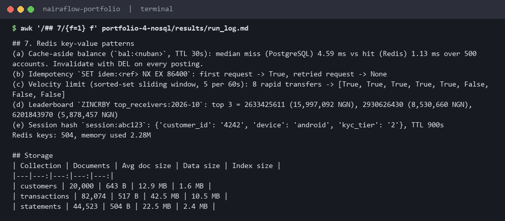
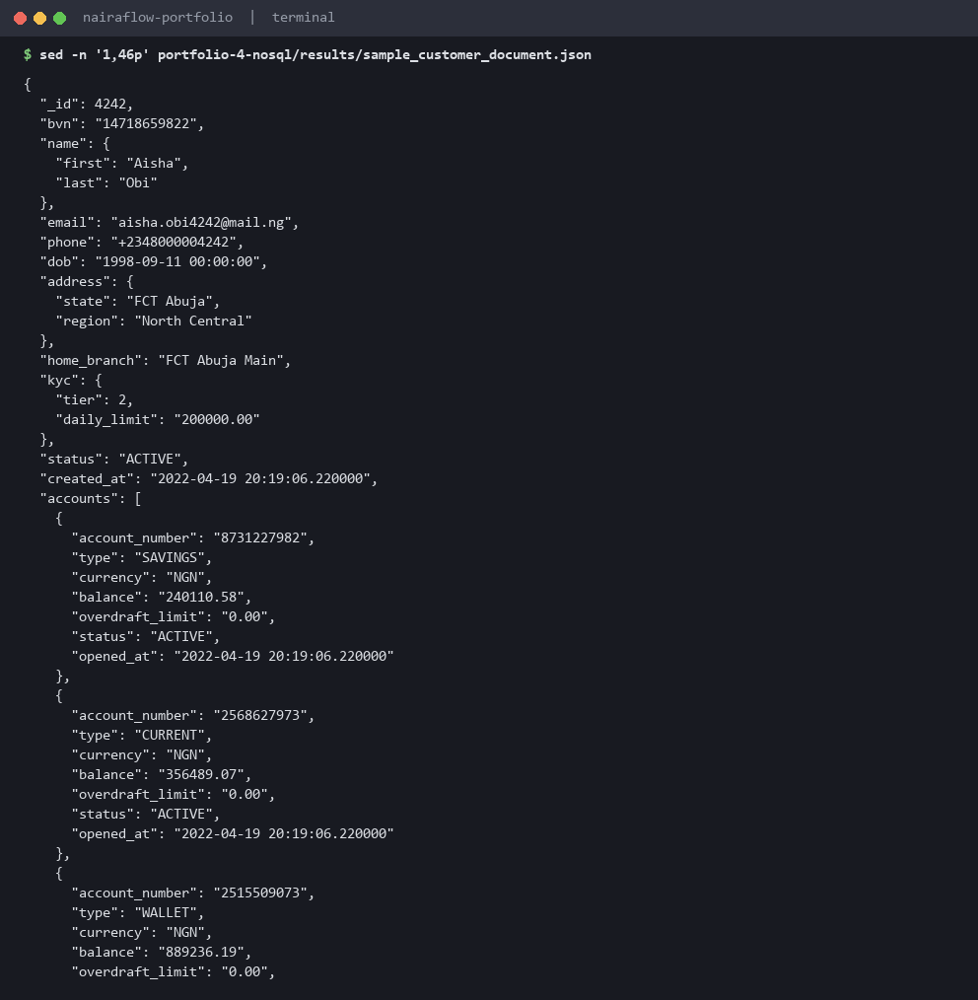

# Portfolio 4: NoSQL and Advanced Data Models

NairaFlow's data is modelled again in **MongoDB 7** (document model, plus graph traversal with `$graphLookup`) and in **Redis 7** (key-value), using the *same* customers, accounts and transactions as Portfolios 1-3. The data is migrated from PostgreSQL by an ETL step, so every result can be checked against the relational version.

| File | Purpose |
|---|---|
| [`run_nosql.py`](run_nosql.py) | ETL, schema validation, index study, aggregations, ACID transaction, graph trace, Redis patterns |
| [`results/run_log.md`](results/run_log.md) | Generated run log with all numbers (main evidence) |
| [`results/sample_*.json`](results/) | Real documents from the run: a customer, a transaction, a statement bucket |
| [`results/explain_index_study.json`](results/explain_index_study.json) | Raw `explain("executionStats")` output before and after indexing |
| [`results/pipelines.js`](results/pipelines.js) | The aggregation pipelines in mongosh syntax |
| [`results/graph_trace.json`](results/graph_trace.json) | Output of the money-flow trace |

## 1. Document model

Relational tables were reshaped around **how the application reads data**, not around normal forms:

| Collection | Shape | Design pattern | Why |
|---|---|---|---|
| `customers` (20,000 docs) | Customer, with **embedded** `accounts[]` (1-3), `kyc{}`, `address{}`, `beneficiaries[]` | Embedding (one-to-few) | The app's home screen needs a profile plus all accounts: **one document read** instead of a 5-table join. Accounts are bounded (`maxItems: 5` in the validator), so the document cannot grow without limit. |
| `transactions` (82,072 docs, Aug-Oct 2026) | One document per txn with **embedded** debit/credit `legs[]`, plus top-level `from`/`to` | Embedding + extended reference | A txn and its legs are always written and read together. `from`/`to` are duplicated out of `legs` so they can be indexed and used as graph edges. |
| `statements` (44,523 docs) | One document per **account per month** with `entries[]` and `closing_balance` | **Bucket pattern** | A monthly statement is a single indexed read. |

Excerpt from [`sample_customer_document.json`](results/sample_customer_document.json):

```json
{ "_id": 4242, "bvn": "14718659822", "name": {"first": "Aisha", "last": "Obi"},
  "phone": "+2348000004242", "address": {"state": "FCT Abuja", "region": "North Central"},
  "kyc": {"tier": 2, "daily_limit": "200000.00"}, "status": "ACTIVE",
  "accounts": [
    {"account_number": "8731227982", "type": "SAVINGS", "balance": "240110.58", "status": "ACTIVE"},
    {"account_number": "2568627973", "type": "CURRENT", "balance": "356489.07", "status": "ACTIVE"},
    {"account_number": "2515509073", "type": "WALLET",  "balance": "889236.19", "status": "ACTIVE"} ] }
```

Money is stored as **`Decimal128`** (exact decimal), never as a double. That's the same rule as `NUMERIC(18,2)` in PostgreSQL.

**Schema validation.** "Schemaless" does not mean "no rules". Both collections have a `$jsonSchema` validator (BVN pattern, `+234` phone pattern, enum statuses, `Decimal128` balances, 1-5 accounts). An invalid customer was rejected with error code 121 on 4 properties: `bvn`, `phone`, `kyc`, `accounts`.

## 2. Indexing (explain `executionStats`)

| Query | Before | After |
|---|---|---|
| Login by phone | COLLSCAN, 20,000 docs examined, 42 ms | IXSCAN `phone_1`, 1 key / 1 doc, 3 ms |
| Customer by account number | COLLSCAN, 20,000 docs, 23 ms | IXSCAN on **multikey** index `accounts.account_number` (indexes each element of the embedded array), 1 / 1, 1 ms |
| Last 20 txns of an account | SORT ← COLLSCAN, 82,072 docs, 125 ms | IXSCAN on compound multikey `(legs.account_number, created_at desc)`, **no in-memory SORT**, 20 / 20, 2 ms |
| Failed transfers queue | SORT ← COLLSCAN, 82,072 docs, 56 ms | IXSCAN `(status, type, created_at)`, 50 / 50, 1 ms |

This matches the PostgreSQL findings in Portfolio 2: **equality fields first, then the sort/range field** (the MongoDB "ESR" rule), so the index returns documents already in order. I also created a partial index (`failed_recent_partial`), but the planner preferred the compound index, which covers `type` as well. That's a reminder that an index is only useful if the planner picks it, and it should be dropped if it stays unused.

## 3. Aggregation pipelines

The Portfolio 2 SQL reports rewritten as pipelines ([`pipelines.js`](results/pipelines.js)):

- **Daily volume per channel** (`$match` → `$group` on `$dateTrunc`): 180 groups in about 106 ms.
- **Top 10 spenders** (`$unwind legs` → `$match` debits → `$group` by customer → `$sort`/`$limit` → `$lookup` customers): about 296 ms. Like the rewritten SQL Q5b, it **aggregates first and only looks up names for the final 10**.

## 4. Multi-document ACID transaction

MongoDB runs here as a replica set (`rs0`), which multi-document transactions require. A transfer updates **two customer documents** (`$inc` on the matching embedded account with the positional `$` operator) and inserts **one transaction document** inside `session.with_transaction()`:

- **Commit:** 25,000 moved, both balances changed together.
- **Abort:** a 999,999,999 transfer raised *insufficient funds* inside the callback, and both balances were unchanged.
- **Idempotency:** replaying a transfer with the same `reference` hit `DuplicateKeyError` on the unique index *after* the two `$inc` updates had run inside the transaction. The whole transaction was rolled back, and the final balances matched the expected values exactly.

(These test transfers change MongoDB only. The Mongo copy is a demonstration target, not a second system of record.)

## 5. Graph model: tracing money flow for the fraud desk

Transfers form a directed graph (account → account). `$graphLookup` walks it recursively, starting from a flagged ₦439,118.98 transfer into a hub account and following onward transfers of at least ₦10,000 within 7 days:

| Hop | Onward transfers found |
|---|---:|
| 1 (direct) | 82 |
| 2 | 195 |
| 3 | 205 |

This took **43 ms**. In SQL this needs a recursive CTE over `ledger_entry`. A dedicated graph database (Neo4j) would be the next step if fraud analytics grew, but `$graphLookup` is enough for a 3-hop investigation.

## 6. Redis: key-value patterns

| Pattern | Keys / commands | Result |
|---|---|---|
| **Cache-aside** balance + stats | `GET`/`SET bal:<nuban> EX 30` | median **4.59 ms** from PostgreSQL (miss) vs **1.13 ms** from Redis (hit), over 500 accounts. Invalidate with `DEL` on each posting |
| **Idempotency key** | `SET idem:<ref> PROCESSING NX EX 86400` | first request `True`, retried request `None` (rejected) |
| **Velocity limit** (fraud rule: max 5 transfers/min) | sorted set `vel:<nuban>`: `ZREMRANGEBYSCORE` + `ZADD` + `ZCARD` in one pipeline | 8 rapid transfers → `[T, T, T, T, T, F, F, F]` |
| **Real-time leaderboard** | `ZINCRBY top_receivers:2026-10 <amount> <nuban>` | top receiving accounts for October, updated per event |
| **Session store** | hash `session:<token>`, `EXPIRE 900` | 15-minute session with automatic expiry |

## 7. Suitability: which model for which NairaFlow workload?

| Workload | Best fit | Reason |
|---|---|---|
| Ledger, balances, transfers | **PostgreSQL** (system of record) | Cross-entity invariants (debits = credits, no overdraft), SERIALIZABLE isolation, deferred constraints, mature ACID. MongoDB *can* do multi-document transactions, but it is designed to make them the exception. |
| Customer profile / app home screen | **MongoDB** | One document per customer matches the screen. Flexible KYC fields (e.g. adding NIN or a selfie-verification block) need no migration. |
| Statements, history, event logs | MongoDB (bucket pattern) or time-series | Append-heavy, read by account and month. Easy to shard by `account_number`. |
| Fraud network analysis | MongoDB `$graphLookup` now, graph DB later | Variable-depth traversal is awkward in SQL |
| Caching, rate limits, idempotency, sessions, leaderboards | **Redis** | Sub-millisecond in-memory operations with TTLs, atomic `INCR`/`ZADD`. Data is disposable or rebuildable. |

**Trade-offs observed:**

- **Duplication:** the customer's region name is copied into every customer document, and `from`/`to` are copied out of `legs`. Updates must touch many documents, which is the price of join-free reads.
- **Bucket outliers:** the busiest account has **3,858 entries in only 3 monthly buckets**. Reading them took 51 ms, and a busy merchant could approach MongoDB's 16 MB document limit. The fix is to cap buckets by count as well as by month (e.g. at most 500 entries per bucket, open a new one when full). The run surfaced this; it isn't fixed yet.
- **Storage:** 82k transactions use 42.5 MB data + 10.5 MB indexes. That's larger per row than PostgreSQL, because BSON repeats field names in every document.
- **Redis is not durable by default.** Every key here is either rebuildable from PostgreSQL (cache, leaderboard) or short-lived by design (idempotency, sessions, velocity windows).

## Screenshots

Terminal captures produced by [`scripts/capture_evidence.py`](../scripts/capture_evidence.py): each image is the real output of the command shown in its title bar (a live `psql` query against the lab database, or the command that prints a committed results file).

**AggregationTransactionGraph**



**ETLValidationIndexes**



**RedisAndStorage**



**SampleCustomerDocument**



## How to run

```bash
docker compose up -d mongo redis postgres
python portfolio-4-nosql/run_nosql.py      # ~2 minutes; needs Portfolio 1 data loaded
```
