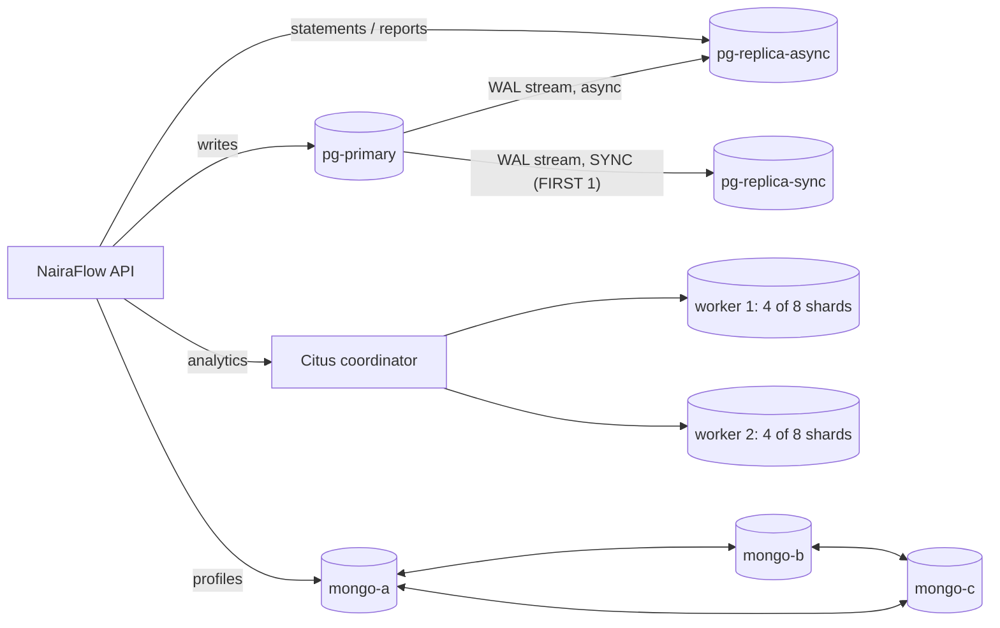

# Portfolio 5: Distributed and Cloud Database Exercise

Three distributed set-ups for NairaFlow were built and *failure-tested* in Docker ([`docker-compose.p5.yml`](docker-compose.p5.yml)). They were then mapped onto a proposed cloud deployment.

| Part | Technology | Concepts demonstrated |
|---|---|---|
| A | PostgreSQL 17 streaming replication: 1 primary, 1 **synchronous** + 1 **asynchronous** hot standby | Replication, read scaling, lag, sync vs async, availability vs consistency, failover, RPO/RTO |
| B | **Citus 13** (distributed PostgreSQL): coordinator + 2 workers | Hash sharding, shard key and co-location, reference tables, router vs scatter-gather queries, distributed 2PC |
| C | **MongoDB 7** 3-node replica set | Majority write concern, automatic election, quorum loss, CAP behaviour |

| File | Purpose |
|---|---|
| [`run_distributed.py`](run_distributed.py) | Runs every experiment (`--only replication|citus|mongo`) |
| [`replication/`](replication/) | Primary init script (replication role) and standby bootstrap (`pg_basebackup -R -C -S`) |
| [`results/run_log_replication.md`](results/run_log_replication.md), [`run_log_citus.md`](results/run_log_citus.md), [`run_log_mongo.md`](results/run_log_mongo.md) | Generated evidence |
| [`results/pg_stat_replication.txt`](results/pg_stat_replication.txt), [`citus_plan_*.txt`](results/), [`citus_2pc_log.txt`](results/citus_2pc_log.txt) | Raw outputs |
| [`cloud/main.tf`](cloud/main.tf) | Terraform for the proposed AWS deployment (**design only, not applied**) |

## Architecture tested



## A. PostgreSQL replication and failover

**Set-up.** Each standby clones the primary with `pg_basebackup -R -X stream -C -S <slot>`. That gives it a physical replication slot, so the primary keeps WAL until the standby has it. Synchronous replication is switched on afterwards with `ALTER SYSTEM SET synchronous_standby_names = 'FIRST 1 (replica_sync)'`.

> **Bug found:** my first version put `synchronous_standby_names` on the primary's command line. The container's own initialisation (`CREATE DATABASE nairaflow`) then hung forever, `waiting for 0/19179B0`, because a synchronous commit needs a standby, and the standbys can only clone the primary *after* initialisation finishes. That's a bootstrap deadlock. Enabling sync replication only once the standbys are streaming is also how it's done operationally.

**A1. Replication works.** The Portfolio 1 generator (3,000 customers, 60k txns) ran against the primary. All three nodes then held identical counts: 64,532 txns and 119,102 ledger rows. Total `sum(balance)` is `0.00` on every node, as double entry requires: the bank's GL account exactly offsets all customer balances. `pg_stat_replication` shows `replica_sync` with `sync_state = sync` and `replica_async` with `async`, both `streaming` with about 5 ms replay lag.

**A2. Standbys are read-only.** An `UPDATE` on the async standby failed with SQLSTATE `25006` (`cannot execute UPDATE in a read-only transaction`). Read scaling is safe, and writes must go to the primary.

**A3. Lag and the cost of durability.** A row committed on the primary became visible on the async standby after a median of **1.4 ms** (p95 6.9 ms, max 26 ms over 200 probes). That is the stale-read window an app reading from a replica must tolerate. Median commit latency by `synchronous_commit` level: `local` 5.96 ms, `remote_write` 5.58 ms, `on` 7.44 ms, `remote_apply` 7.35 ms. On a single Docker host the network hop is tiny, so the difference is small and partly hidden by noise from the loaded host. Across availability zones (about 1-2 ms RTT) or regions (tens of ms) the gap grows by the round-trip time, which is why only the in-region standby is synchronous.

**A4. Synchronous standby down = writes stop.** With `pg-replica-sync` stopped, a `COMMIT` on the primary did not return. `pg_stat_activity` showed `wait_event = IPC/SyncRep`. It completed (6.2 s total) only when the standby came back. This is the **C over A** choice: NairaFlow will not acknowledge a transfer that exists on only one machine. The availability escape hatch is a quorum (`ANY 1 (replica_sync, replica_async)`) or `synchronous_commit = local`, at the price of possible loss on failover.

**A5. Primary crash under live load.** A writer thread ran real transfers through `bank.transfer_funds()` and recorded the reference of every transfer whose COMMIT was *acknowledged*. Then `docker kill pg-primary` was run:

| Measure | Result |
|---|---|
| Acknowledged transfers before the crash | 218 |
| Found on the promoted standby | **218 → RPO = 0** |
| `pg_promote()` done after kill | 3.11 s |
| First write accepted on the new primary | **3.16 s** (manual promotion; automated detection with Patroni or RDS Multi-AZ typically takes 10-60 s) |
| Unbalanced transactions on the new primary | 0 (no torn transfers) |

The async standby was left following a dead primary. It has to be re-pointed (`primary_conninfo`) or rebuilt with `pg_rewind`. That is exactly the bookkeeping that Patroni or a managed service automates.

## B. Sharding with Citus

**Shard key = `customer_id`.** `customer`, `account` and `ledger_entry` are hash-distributed by `customer_id` into 8 shards and **co-located**, so one customer's profile, accounts and ledger always live on the same worker and joins between them never cross the network. `region` and `state` are **reference tables**, replicated to every node so joins with them stay local. Two alternatives were rejected:
- `account_id` would split a customer's accounts across nodes, which hurts the most common query, the customer home screen.
- `created_at` would send every new write to the same "latest" shard (a hot spot).

| Worker | Shard objects | Size | ledger_entry rows |
|---|---:|---:|---:|
| citus-w1 | 14 | 25 MB | 188,566 (60%) |
| citus-w2 | 14 | 19 MB | 128,048 (40%) |

**Skew.** Hashing spreads *customers* evenly, but not *activity*. The Portfolio 1 data is deliberately Zipf-like, and a few very busy customers happened to hash to shards on worker 1. In production, the fix is to rebalance shards between nodes (`citus_rebalance_start()` moves whole shards online) or to use more shards than nodes, as done here: 8 shards on 2 workers, so shards can be moved.

**Router vs multi-shard queries** (plans in `results/citus_plan_*.txt`):
- One customer's statement (`WHERE customer_id = 501`): `Task Count: 1`, about **0.35 ms**. The coordinator routes the whole query to the one shard that owns that customer.
- Debits by region across everyone: `Task Count: 8`, about **270 ms**. Eight shard queries run in parallel on both workers, and the coordinator merges partial aggregates (scatter-gather).

**Cross-shard transfer = two-phase commit.** A transfer between customer 2 (worker 1) and customer 3 (worker 2) in one `BEGIN … COMMIT`. With `citus.log_remote_commands = on`, the coordinator issued `BEGIN … assign_distributed_transaction_id(…)` and then **`PREPARE TRANSACTION 'citus_0_152_12_35'`** and **`'citus_0_152_12_36'`** on the two workers (phase 1). Phase 2 (`COMMIT PREPARED`) runs from the coordinator's post-commit callback, after the client's COMMIT has returned, so it is not echoed back to the client. If a worker crashes between the phases, Citus's recovery daemon completes or aborts the prepared transactions using its `pg_dist_transaction` records. The cost is extra round trips and locks held across nodes. That's why choosing a shard key that keeps most operations single-shard matters so much.

## C. MongoDB replica set: election and quorum

| Step | Observation |
|---|---|
| Insert 1,000 docs with `w: "majority"` | 453 ms; each acknowledged only once 2 of 3 nodes had it |
| `docker kill` the primary (`mongo-a`) | `mongo-b` elected primary about **13 s** later (default `electionTimeoutMillis` = 10 s, plus the election itself) |
| `w: majority` write after failover | Succeeded (2 of 3 = quorum). All 1,000 earlier majority writes were present: no loss |
| Kill a second node | The last survivor **stepped down to SECONDARY**. Writes failed with `NotWritablePrimary`, but reads with `secondaryPreferred` still returned all 1,001 docs |
| Restart both | Both rejoined and caught up from the oplog: 1 PRIMARY + 2 SECONDARY |

## Discussion: CAP and PACELC for NairaFlow

- During a **partition**, all three systems as configured choose **consistency**. PostgreSQL blocks commits without its sync standby (A4). MongoDB refuses writes without a majority (C). Citus's 2PC will not commit unless every participant prepared. For a bank, *refusing* a transfer is recoverable, and *losing or duplicating* one is not.
- **Else** (normal operation, PACELC's "E"), the trade-off is **latency vs consistency**: the synchronous standby adds a round trip to every commit (A3), and reading from replicas is fast but up to milliseconds stale. NairaFlow reads balances for transfers from the primary only and serves statements, history and reports from replicas.
- **Replication vs sharding.** Replication (A, C) buys availability and read scale, but every node still stores everything and takes every write. Sharding (B) is the only way to scale *writes* and storage beyond one machine, at the cost of distributed transactions and possible skew. At NairaFlow's current size (1.2M ledger rows) one primary is plenty. Sharding becomes relevant at hundreds of millions of rows per year.

## Proposed cloud deployment

[`cloud/main.tf`](cloud/main.tf) captures the target design as Terraform. **It has not been applied**: this portfolio uses only local Docker, and no cloud account was charged.

| Component | Service | Maps to experiment |
|---|---|---|
| Ledger / system of record | Amazon RDS for PostgreSQL 17, **Multi-AZ** (synchronous standby in a second AZ, automatic failover), encrypted, 35-day PITR backups | A4, A5 |
| Statements / reporting | RDS async **read replica** | A2, A3 |
| Customer profiles, statements archive | MongoDB Atlas 3-node replica set across 3 AZs, `w: majority` | C |
| Cache, idempotency, rate limits | ElastiCache for Redis, Multi-AZ with automatic failover | Portfolio 4 |
| Scale-out later | Citus (Azure Cosmos DB for PostgreSQL, or self-managed) if write volume outgrows one primary | B |

**Region and data residency.** AWS `af-south-1` (Cape Town) is the closest AWS region to Lagos, but it is outside Nigeria. Before choosing it, NairaFlow would have to confirm the CBN and Nigeria Data Protection Act 2023 requirements on where customer and transaction data may be stored and on cross-border transfers. If in-country hosting is required, the same architecture can run on a Nigerian data centre or a local cloud provider using the open-source pieces tested here (PostgreSQL streaming replication with Patroni, a MongoDB replica set, Redis Sentinel). The Docker lab is a scaled-down version of exactly that.

**Targets.** RPO = 0 for committed transfers (synchronous standby, proven in A5). RTO under about 60 s (automated failover; manual promotion took 3.2 s in A5). The disaster-recovery copy in a second region is asynchronous, so its RPO is seconds, which is accepted for a full-region outage.

## How to run

```bash
python portfolio-5-distributed-cloud/run_distributed.py --only replication   # ~6 min on a loaded laptop
python portfolio-5-distributed-cloud/run_distributed.py --only citus         # needs Portfolio 1 data in nf-postgres
python portfolio-5-distributed-cloud/run_distributed.py --only mongo
```

Each part starts its containers, runs, and removes them (`docker compose rm -sfv`) so the parts never compete for memory.
